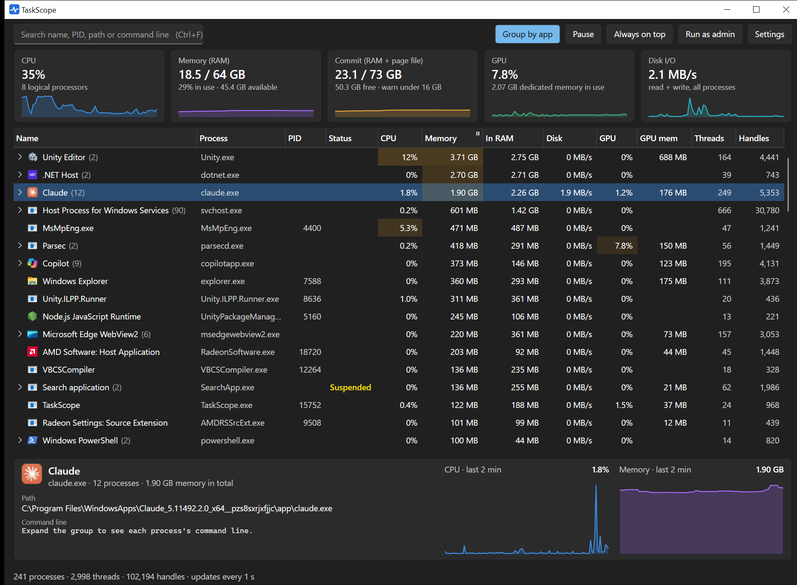

# TaskScope

A faster, more informative replacement for Windows Task Manager, built to stop memory-hungry jobs from taking the whole PC down.

Windows can run out of **commit** (memory that programs have reserved, backed by RAM + the page file) long before RAM looks full. When it does, programs and drivers crash. Task Manager barely shows this, so TaskScope puts it front and center and gives you ways to act before it's too late.



## Features

**Memory safety**
- **Commit tile**: committed memory vs. the commit limit, with history. It turns red, shows a banner listing the biggest processes, and sends a Windows notification when free commit drops below a threshold you choose (default 16 GB).
- **Pause (suspend) / Resume**: freeze a runaway process so it stops growing without losing its work, then resume it when there's room.
- **Memory watches**: rules like *"if `java.exe` goes over 20 GB, notify me / pause it / end it."* Create one from the right-click menu (**Watch memory…**) or in Settings.

**Better process list**
- Every process is read in a single `NtQuerySystemInformation` call, so updates are cheap even with hundreds of processes.
- Group by app, with expandable groups, or a flat list.
- Columns: CPU, committed memory, RAM (working set), disk I/O, GPU %, GPU memory, threads, handles, and a **Suspended** status (detected from thread wait states).
- Search by name, PID, path, **or command line**, so you can tell your `python.exe` processes apart.
- A details pane with path, full command line, parent process, start time, priority, and 2-minute CPU and memory graphs.
- Heat shading on busy cells, and live tiles for CPU, RAM, commit, GPU and disk.

**Actions**
- End task, End process tree, Pause/Resume, Set priority, Open file location, and copy name/PID/path/command line.
- Warns before you end or pause critical Windows processes.
- Protects against PID reuse: every action checks the process creation time first.
- **Run as admin** button for controlling elevated and system processes.
- Tray icon with a live summary tooltip; alerts appear as Windows notifications.

## Keyboard

| Key | Action |
| --- | --- |
| `Ctrl+F` | Search |
| `Esc` | Clear search |
| `Del` | End selected process(es) |
| `Space` | Freeze/unfreeze the list (graphs keep running) |
| `→` / `←` | Expand / collapse a group |

## Requirements

- Windows 10 or 11, x64
- [.NET 10 Desktop Runtime](https://dotnet.microsoft.com/download/dotnet/10.0) (to run) or the .NET 10 SDK (to build)

## Build and run

```bash
dotnet build -c Release
```

```bash
dotnet run -c Release
```

To produce a single `TaskScope.exe`:

```bash
dotnet publish -c Release -r win-x64 --self-contained false -p:PublishSingleFile=true -o publish
```

## Settings

Settings (warning threshold, update speed, memory watches, window position) are stored in `%AppData%\TaskScope\settings.json`.

## How it works

| File | What it does |
| --- | --- |
| `Sampler.cs` | Process snapshot via `NtQuerySystemInformation(SystemProcessInformation)`, CPU/disk deltas, path and command-line lookup, GPU usage via PDH `GPU Engine` / `GPU Process Memory` counters |
| `Models.cs` | Row view models (process and app group), formatting, heat shading |
| `Actions.cs` | End, suspend/resume (`NtSuspendProcess`), and priority, all guarded against PID reuse |
| `MainWindow.xaml(.cs)` | UI, list reconciliation (keeps selection and scroll position across updates), alerts, tray |
| `SettingsWindow.xaml(.cs)` | Threshold, update speed, memory watch rules |
| `Ui.cs` | Sparkline graph control and icon helpers |

The UI uses WPF's Fluent theme and follows the Windows light/dark setting.

## License

[MIT](LICENSE)
